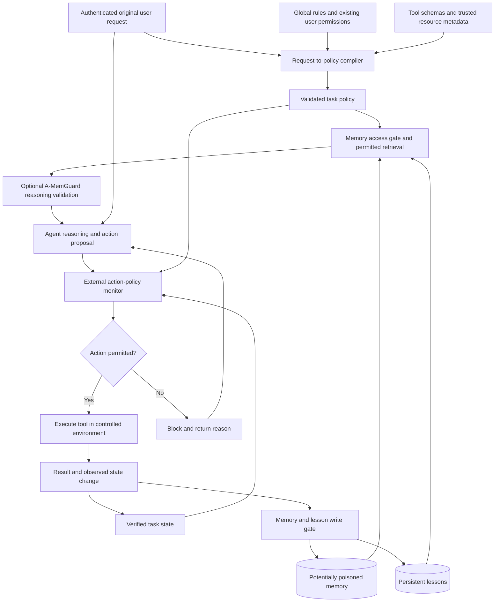

# Contextual Defense for Memory-Augmented Agents

## 1. Our idea

An agent may read from a memory store that already contains poisoned records. We want a contextual boundary that dynamically permits only the memory access and actions authorized for the current user request.

The blood-brain barrier analogy motivates selective admission of memory into the agent's context. The operating-system analogy motivates enforcing permissions outside the agent, before an action executes.

The original, authenticated user request determines task-specific restrictions. Those restrictions operate within global rules and the user's existing permissions:

```text
Allowed behavior = Global rules
                   intersect Existing user permissions
                   intersect Request-specific permissions
```

For example, “Send Alice the Project X update on Slack” may permit reading relevant Project X updates, resolving Alice's identity through an authorized directory lookup, and sending the requested Slack message. It does not grant permission to email everyone, purchase something, or disclose unrelated private records. Retrieved memory may supply task information; it cannot grant these extra permissions.

Our hypothesis is that selective memory admission and external action enforcement can reduce the consequences of poisoned memory while preserving legitimate task completion. Permission enforcement alone does not establish that information is true or that an authorized message is appropriate.

## 2. Proposed architecture



This diagram describes the proposed system. It is not a diagram of the current A-MemGuard implementation.

The compiler should establish policy before admitting untrusted task memory. Policy updates must come from authenticated user changes or previously authorized, verifiable task transitions. Agent reasoning, tool-returned instructions, and lessons cannot independently expand permissions. Tool results must pass the relevant admission rules before entering subsequent agent context.

### Trust assumptions and scope

- An adversary may control designated memory content, but not the authenticated request, global policy, reference monitor, or protected metadata store.
- Ownership, sensitivity, provenance, and permission labels come from trusted infrastructure. A record's own claim that it is trusted is insufficient.
- Existing records without reliable provenance require a defined restricted-use or quarantine policy. Adding metadata later does not establish their historical origin.
- Every applicable memory read, lesson read, and tool execution must pass through the monitor. Unmediated access falls outside the enforcement claim.
- The experiment must state which components may inspect denied content. A filter that reads a prohibited record has already accessed it; filtering afterward cannot support a claim that no component accessed that record.
- The simulated environment should have observable tool effects, enabling evaluation of executed behavior ratwhher than generated text alone.

## 3. Research direction 1: Reliable request-to-policy inference

**Question:** Can natural-language requests be translated into precise permissions without granting excessive authority or blocking necessary work?

**Proposed method:** Build a policy compiler whose inputs are the original request, user permissions, global restrictions, tool schemas, and trusted resource metadata. Its structured output specifies allowed reads, operations, recipients, resource identifiers, argument constraints, action counts, and expiration conditions. Separate explicit permissions from uncertain interpretations.

An illustrative policy for the Slack task is:

```yaml
task: send_project_update
read_resources:
  - project_x_updates
  - authorized_coworker_directory
allowed_operation: slack.send_message
recipient_constraint: verified_alice_identity
maximum_sends: 1
expires: task_completion
```

This is an explanatory schema, not an implemented policy language. The final schema must support legitimate multi-step work and multiple authorized operations.

**Learning contribution:** Train or calibrate the compiler to recognize ambiguity. It should ask a targeted clarification for an uncertain consequential operation while allowing independent authorized steps. Compare with prompting alone and simple rule-based extraction.

**Experiments:** Annotate ground-truth policies for requests with paraphrases, ambiguous recipients, multi-step dependencies, and authenticated changes of intent. Hold out task families and resource combinations. Evaluate each request with both an annotated oracle policy and an inferred policy to separate interpretation failures from enforcement failures. No model-inferred policy should serve as its own evaluation ground truth.

**Metrics:** Excessive permission grants, omission of necessary permissions, clarification rate, legitimate task completion, and downstream scope violations.

**A-MemGuard reuse:** Preserve the original question before modifying queries or producing search actions. Add the compiler before retrieval; its policy is independent of memory-consistency judgments.

**Closest suggested paper:** Task Shield, described in section 7. Its task-alignment perspective makes it a necessary comparison, but our proposed contribution is a structured, uncertainty-aware policy governing both memory admission and action execution.

**Reviewer concern:** Correct enforcement of an overbroad inferred policy is still a failure. Report policy-inference and policy-enforcement errors separately.

## 4. Research direction 2: Policy-constrained memory selection

**Question:** Can the agent receive less potentially harmful memory while retaining the evidence needed for legitimate tasks?

**Proposed method:** Separate authorization, relevance, and reasoning safety. Trusted access rules first restrict eligible records. A policy-conditioned selector then chooses useful records or permitted passages within an exposure budget. A-MemGuard may validate reasoning supported by the admitted candidates.

Authorization is enforced by trusted policy and metadata; a relevance score cannot override it. Authorized records may still be poisoned, so memory admission and reasoning validation address different failure modes.

**Learning contribution:** Learn which authorized evidence is sufficient for a task and when more context is needed. Evaluate whether a learned selector improves the security–utility trade-off over static masks and ordinary top-K retrieval.

**Experiments:** Construct controlled memory stores containing clean relevant, clean irrelevant, inaccessible, and poisoned-but-accessible records. Compare ordinary retrieval, static access rules, A-MemGuard, contextual selection, and contextual selection plus A-MemGuard. Match context budgets or show results across budgets to distinguish policy benefits from simply reducing context length. Vary corpus size and contamination levels using controlled fixtures.

**Metrics:** Legitimate task completion, authorized-evidence recall, prohibited-content exposure at each monitored component, amount of admitted context, latency, and cost.

**A-MemGuard reuse:** StrategyQA provides an initial retrieval scaffold. Add independently annotated permission labels; existing relevance labels do not establish authorization. The current QA track can evaluate memory selection, but cannot substantiate broad tool-capability claims.

**Closest suggested papers:** A-MemGuard supplies the memory-validation baseline; Fides motivates explicit confidentiality and integrity controls. Our candidate contribution is learning useful memory selection within a fixed permission boundary.

**Reviewer concern:** A selector might suppress inconvenient evidence and appear secure by becoming unhelpful. Evaluate authorized-evidence retention and task completion together with exposure.

## 5. Research direction 3: Joint memory and action enforcement

**Question:** Does enforcing one task policy at both memory admission and tool execution improve security or utility beyond either boundary alone?

**Proposed method:** Place a trusted monitor outside the agent. It checks each memory request and each proposed tool invocation, including its arguments. The policy may permit actions only at specified task states, using independently verified tool effects to track progress. Memory can inform permitted operations but cannot change their authorization.

For a Slack task, allowing the Slack tool is insufficient: recipient, resource scope, permitted content sources, and repetition limits may matter. Checking the recipient does not prove the message's factual correctness or automatically prevent every semantic disclosure.

**Scientific contribution:** Establish a precise composition model for request-derived memory permissions and state-dependent tool permissions. Isolate what improves over established capability and information-flow defenses. A wrapper around tool names alone would provide weak novelty.

**Experiments:** Extend a tool-executing benchmark with persistent memory. Use controlled local services with inspectable state changes. Compare neither boundary, memory boundary only, action boundary only, and both. Separately evaluate an oracle policy and a compiled policy. Include legitimate workflows that require intermediate reads so the monitor is tested for expressiveness as well as restriction.

**Metrics:** Unauthorized actions proposed, blocked, and executed; violations by recipient, resource, operation, and repetition; legitimate completion; intervention frequency; overhead.

**Conditional property:** Given a correct policy and complete mediation, every executed tool call must satisfy the relevant policy checks. This does not prove correct interpretation of intent or truthfulness of generated content.

**A-MemGuard reuse:** Reuse memory representations and optional checking. The inspected EHR path saves generated code without executing it, so it needs a controlled execution harness before it can evaluate action effects. AgentDojo is a recommended alternative foundation for that part.

**Closest suggested papers:** CaMeL and Fides. These already enforce security outside the model, so request-derived persistent-memory scope and its measurable interaction with action scope must be specified as the proposed extension.

**Reviewer concern:** Report the incremental benefit of memory gating when an action monitor already exists. Avoid attributing all gains to a more restrictive execution environment.

## 6. Research direction 4: Contextual lessons across sessions

**Question:** Can lessons improve future decisions without letting old permissions or contaminated lessons acquire authority over new requests?

**Proposed method:** Persist lessons with their originating task scope, protected source metadata, observed failure, violated constraint, and applicability conditions. Retrieve lessons under the current task policy. Preserve source restrictions through summaries and merges. Define expiration, revocation, and revision rules.

A lesson may recommend caution or extra validation; it cannot independently authorize a tool or recipient. A lesson about one Slack workflow should not become a universal restriction on communication. Likewise, an old authorization should not automatically apply to a later task.

**Learning contribution:** Learn when a prior lesson applies and when it is stale, while an external monitor prevents lessons from granting authority. Compare semantic similarity alone with retrieval conditioned on task scope and permission state.

**Experiments:** Run complete task sequences with legitimate changes of recipient, project, access rights, and user intent. Include stale and contradictory lessons, revocation, and controlled memory transformations. Compare no lessons, unrestricted lessons, and scoped lessons. Split by entire sequence to prevent shared lessons leaking between development and evaluation.

**Metrics:** Cumulative violations, recurrence of previously observed failures, stale-permission use, unnecessary restrictions, task completion over time, and adaptation after authenticated scope changes.

**A-MemGuard reuse:** The supplied EHR branch attaches rejected reasoning paths as lessons to memory records. The inspected active path does not persist them across process restarts; ReAct has no comparable lesson branch. Persistent storage and scope metadata therefore require implementation. The paper's broader dual-memory design and the checkout's narrower implementation must be distinguished.

**Closest suggested papers:** A-MemGuard for lessons, the memory-authority preprint for persistent authority, and Bad Memory for cross-session evaluation.

**Reviewer concern:** Scoped lessons must outperform simply retaining restrictive rules. Test their useful adaptation and explain how permission changes are authenticated. Persistent origin labels alone are already studied in prior work.

## 7. Four main suggested papers: What they are about

The four research directions above are our proposals. The four papers below are existing related works, not four papers we propose to write. Each may inform several directions.

| Paper | What it studies | Why it matters to us | Role |
| --- | --- | --- | --- |
| [Task Shield: Enforcing Task Alignment to Defend Against Indirect Prompt Injection in LLM Agents](https://arxiv.org/abs/2412.16682) | A defense that checks whether instructions and tool calls contribute to user-specified goals. | Closest conceptual comparison for task-dependent decisions. We need to show what explicit memory permissions and policy inference add. | Task-alignment baseline; especially direction 1. |
| [Defeating Prompt Injections by Design — CaMeL](https://arxiv.org/abs/2503.18813) | Separates control and data flows from a trusted query and applies capability-based policies at tool calls. | A concrete reference for enforcing boundaries outside the LLM. Adding capabilities alone would overlap with this work. | Architecture and enforcement baseline; especially direction 3. |
| [Securing AI Agents with Information-Flow Control — Fides](https://arxiv.org/abs/2505.23643) | Models agent information flow and uses confidentiality/integrity labels with deterministic enforcement and selective information hiding. | Helps distinguish permitted reads, information influence, and permitted outputs. Our selector must operate within access rules. | Information-flow baseline; especially directions 2 and 3. |
| [Securing LLM-Agent Long-Term Memory Against Poisoning: Non-Malleable, Origin-Bound Authority with Machine-Checked Guarantees](https://arxiv.org/abs/2606.24322) | Proposes TMA-NM, which binds authority to memory origins and preserves restrictions through transformations under a formal threat model. | Direct overlap with persistent memory authority. Our potential extension concerns changing task scopes and lesson applicability across sessions. | Closely related memory-security preprint; especially direction 4. |

The fourth paper is a preprint. Its formal and empirical claims depend on its stated assumptions and evaluation conditions; this document does not independently reproduce them. Code compatibility and reproduction of any suggested baseline remain unverified.

### Supporting papers and benchmark

| Reference | What it is about | How we would use it |
| --- | --- | --- |
| [A-MemGuard: A Proactive Defense Framework for LLM-Based Agent Memory](https://arxiv.org/abs/2510.02373) | Validates memory-induced reasoning through consensus and consults lessons distilled from previous failures. | Memory retrieval/checking scaffold and lesson baseline; not an established working implementation of our proposed policy boundary. |
| [AgentDojo: A Dynamic Environment to Evaluate Prompt Injection Attacks and Defenses for LLM Agents](https://arxiv.org/abs/2406.13352) | An extensible environment for executable agent tasks involving untrusted tool data. | Foundation for observable tool effects; we would add persistent memory and permission annotations. |
| [Bad Memory: Evaluating Prompt Injection Risks from Memory in Agentic Systems](https://arxiv.org/abs/2607.14611) | Studies persistent-memory risks and effects across current and later sessions in a synthetic workspace. | Reference for longitudinal evaluation and memory persistence. |

Suggested reading order: Task Shield for task alignment; CaMeL and Fides for enforcement architecture; the memory-authority preprint for persistent authority; A-MemGuard for integration; AgentDojo and Bad Memory for evaluation design.

## 8. Is A-MemGuard a suitable foundation?

**Partially.** The existing [repository assessment](MEMGUARD_ASSESSMENT_README.md) identifies reusable retrieval, memory representations, checking components, and logging. It also records incompatible checker interfaces, missing EHR memory logs, and incomplete configuration. These are inspection findings, not reproduced runtime failures.

Repairing the checkout establishes an experimental baseline. It does not by itself implement contextual authorization or demonstrate the proposed research contribution.

The recommended combination is A-MemGuard-style memory retrieval and checking, a new policy compiler and memory-access gate, and a controlled tool-execution environment such as an extended AgentDojo setup. The exact integration and baseline reproduction must be verified before claiming performance gains.

## 9. Recommended implementation and evaluation plan

| Stage | Concrete deliverable | What it establishes |
| --- | --- | --- |
| 1. Establish baseline | Repair necessary interfaces, obtain required assets, and document one reproducible memory-agent run. | A working comparison rather than assumptions from source inspection. |
| 2. Define task scope | Specify a policy schema and independently annotate permissions for a small set of executable tasks. | Ground truth for memory and action authorization. |
| 3. Enforce oracle policies | Implement memory and action gates using annotated policies first. | Whether enforcement and task expressiveness work before introducing inference errors. |
| 4. Infer policies and select memory | Add request-to-policy inference and selection within authorized records. | The core learning contribution in directions 1 and 2. |
| 5. Compare boundaries and baselines | Run the four-way boundary ablation and relevant existing defenses on matched tasks. | Where improvements originate and how they compare with related work. |
| 6. Extend across sessions | Persist scoped lessons and evaluate authenticated scope changes and revocation. | The longitudinal contribution in direction 4. |

Use held-out tasks and domains, repeated runs, uncertainty intervals, and documented denominators. Report all-task legitimate completion as well as security outcomes; success only on already-solvable tasks should be labeled as a conditional metric. Measure actual environment state changes rather than treating error rate or an attack-marker string as proof of an unauthorized action. Report latency, context volume, and model-call cost alongside security and utility.

For an initial paper, prioritize directions 1 and 2 as the learning contribution, direction 3 as the enforcement and evaluation foundation, and direction 4 as a subsequent extension. The candidate claim is that request-derived policies improve the security–utility trade-off for memory-augmented agents under explicitly stated assumptions. Novelty and that claim remain to be established experimentally.
